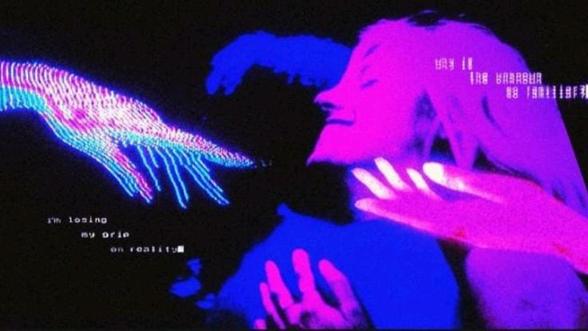
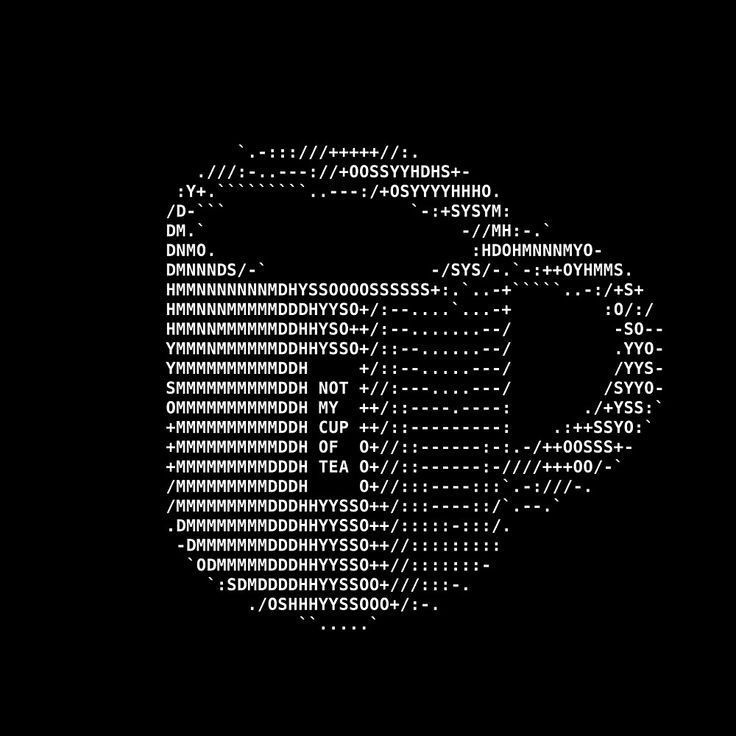

<!--
╔══════════════════════════════════════════════════════════════════╗
║                       README DE GIANFRANCO                      ║
╠══════════════════════════════════════════════════════════════════╣
║ ANTES DE PUBLICAR:                                               ║
║ 1. Subí las imágenes a /assets con los nombres indicados abajo.  ║
║ 2. Reemplazá los datos de contacto entre los placeholders.       ║
║ 3. Completá los repositorios destacados.                         ║
║ 4. Reemplazá TU_USUARIO en Ko-fi si querés habilitar Support Me. ║
╚══════════════════════════════════════════════════════════════════╝

Paleta: negro espacial · violeta · magenta · coral · ámbar.
-->

<!-- ═══════════════════════ BANNER PRINCIPAL ═══════════════════════ -->

  

  

---

<!-- ═══════════════════════ INTRODUCCIÓN ═══════════════════════════ -->

<table>
  <tr>
    <td width="58%" valign="top">

<h2>¡Hola! Soy Gianfranco 👋</h2>

<!-- CONTACTOS PRINCIPALES: reemplazá los enlaces, no los logos. -->

  
  &nbsp;
  
  &nbsp;
  
  &nbsp;
  
  &nbsp;
  

  Soy estudiante de programación y me interesa entender cómo funciona
  la tecnología, desde el software hasta la infraestructura que lo hace posible.

  Disfruto experimentar con sistemas, explorar herramientas y automatizar
  tareas. Me atraen especialmente las tecnologías abiertas y la posibilidad
  de comprender qué ocurre detrás de cada herramienta.

<strong>Áreas de interés</strong>

  ◈ Ciberseguridad 
  ◈ Bases de datos 
  ◈ Automatización 
  ◈ Cloud computing 
  ◈ Software libre

<blockquote>
  <em>“Carpe diem for himself and laissez-faire for others.”</em>
</blockquote>

    </td>

    <td width="42%" valign="top">

<h3>▌ SYSTEM SNAPSHOT</h3>

Un vistazo a mi entorno principal.

<pre><code>┌─[gianfranco@endeavouros]─[~]
└─$ fastfetch

OS        EndeavourOS
WM        i3
SHELL     Bash
TERM      xfce4-terminal
EDITOR    Visual Studio

┌────────────────────────┐
│                        │
│   curiosity.exe --run  │
│                        │
└────────────────────────┘</code></pre>

    </td>
  </tr>
</table>

---

<!-- ═══════════════ SISTEMAS, LENGUAJES Y HERRAMIENTAS ══════════════ -->

<h2 align="center">⟡ STACK &amp; TOOLKIT</h2>

  Solo logos: pasá el cursor sobre cada uno para ver su nombre.

<h3>01 / Sistemas operativos</h3>

<!-- Sistemas que uso o que he probado. EndeavourOS es mi sistema principal. -->

  
  &nbsp;&nbsp;
  
  &nbsp;&nbsp;
  
  &nbsp;&nbsp;
  
  &nbsp;&nbsp;
  

<h3>02 / Lenguajes, web y bases de datos</h3>

  
  &nbsp;&nbsp;
  
  &nbsp;&nbsp;
  
  &nbsp;&nbsp;
  
  &nbsp;&nbsp;
  
  &nbsp;&nbsp;
  
  &nbsp;&nbsp;
  
  &nbsp;&nbsp;
  
  &nbsp;&nbsp;
  

<h3>03 / Infraestructura, redes y automatización</h3>

  
  &nbsp;&nbsp;
  
  &nbsp;&nbsp;
  
  &nbsp;&nbsp;
  
  &nbsp;&nbsp;
  
  &nbsp;&nbsp;
  

<h3>04 / Asistentes de IA</h3>

  
  &nbsp;&nbsp;
  
  &nbsp;&nbsp;
  

---

<!-- ═══════════════════════ PROYECTOS ══════════════════════════════ -->

<h2 align="center">⟡ PROYECTOS DESTACADOS</h2>

  Proyectos personales, experimentos y herramientas que voy desarrollando.

<table>
  <tr>
    <td width="50%" valign="top">

<h3>⌁ Proyecto 01</h3>

<strong>[Nombre del proyecto]</strong>

  [Contá qué hace, qué problema intenta resolver y qué lo hace interesante.]

  Stack: [C++ · JavaScript · Bash · etc.]

  <a href="https://github.com/GianfrancoNegri/REPOSITORIO_01">
    ↗ Ver repositorio
  </a>

    </td>

    <td width="50%" valign="top">

<h3>⌁ Proyecto 02</h3>

<strong>[Nombre del proyecto]</strong>

  [Describí su objetivo, alguna característica y lo que aprendiste al crearlo.]

  Stack: [Tecnologías utilizadas]

  <a href="https://github.com/GianfrancoNegri/REPOSITORIO_02">
    ↗ Ver repositorio
  </a>

    </td>
  </tr>
</table>

  

---

<!-- ═══════════════════════ ESTADÍSTICAS ═══════════════════════════ -->

<h2 align="center">⟡ GITHUB ANALYTICS</h2>

  Actividad y lenguajes presentes en mis repositorios de GitHub.

  
  

  

---

<!-- ═══════════════════════ SPOTIFY ════════════════════════════════ -->

<h2 align="center">⟡ NOW PLAYING</h2>

  Un pequeño espacio para la música que acompaña el proceso creativo.

<!-- El widget conserva el identificador de Spotify del README anterior.
     Si querés cambiar de cuenta, reemplazá el valor uid. -->

  

<!-- SPOTIFY CODE:
     1. Descargá el Spotify Code de una canción o playlist.
     2. Subilo al repositorio como assets/spotify-code.png.
     3. Eliminá los comentarios que rodean este bloque para mostrarlo.

  
   
  Escanealo desde Spotify.

-->

---

<!-- ═══════════════════════ UN POCO MÁS PERSONAL ═══════════════════ -->

<h2 align="center">⟡ BEYOND THE TERMINAL</h2>

<table>
  <tr>
    <td width="62%" valign="middle">

  La tecnología es una parte de lo que me interesa, pero también me gusta
  explorar ideas creativas y experimentar con herramientas diferentes.

  Fuera de la programación, este espacio también puede reflejar otros
  intereses: música, escritura, proyectos creativos y cualquier cosa que
  despierte mi curiosidad.

  
    <!-- Podés reemplazar el texto anterior por tus hobbies, música favorita,
         juegos, libros, proyectos personales o cualquier otro interés. -->
    Siempre hay algo nuevo que descubrir.
  

    </td>

    <td width="38%" align="center" valign="middle">

      

    </td>
  </tr>
</table>

---

<!-- ═══════════════════════ VISITAS ════════════════════════════════ -->

  

  

  
    <em>Stay curious. Understand the system. Build something meaningful.</em>
  

<!-- ═══════════════════════ SUPPORT ME ═════════════════════════════ -->

<!-- Reemplazá TU_USUARIO por tu nombre de usuario de Ko-fi.
     Si todavía no tenés una página de apoyo, podés dejarlo comentado
     hasta crearla o eliminar este bloque. -->

  

